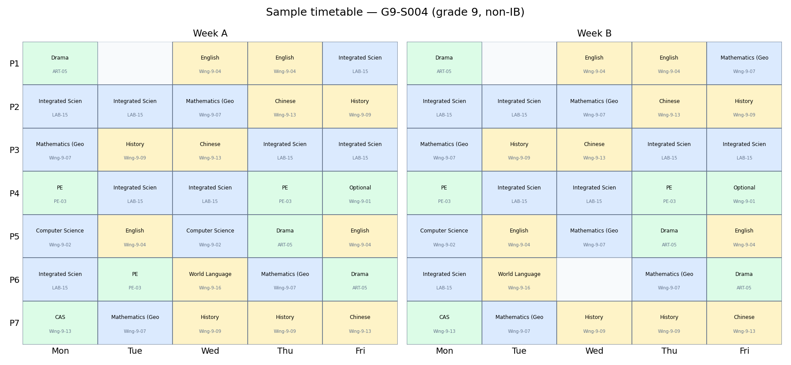
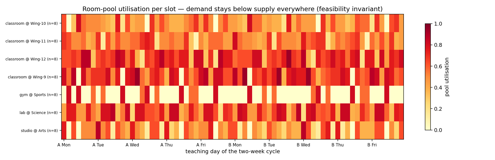

# HackSHSID 2026 · Track 1 — Rebuilding the Course Scheduling System

An automatic timetabling engine that turns the school's course requirements
(`modules.xlsx`) into a full two-week timetable for every student, teacher
and room — satisfying **all hard constraints (H1–H10 from the brief, plus
the school's grade-synchronisation rule)** and cutting the measured
soft-penalty burden by **more than half** compared with a current-style
rigid timetable.

Verified at full school scale: **1 000 students** (≈250 per grade,
20 per class), 65 cohort clusters, 529 lessons, 607 sections, ~320 teachers,
112 rooms — **0 hard violations on 10/10 tested seeds**, ~45 s per
optimisation pass (~2 min for the default best-of-3 run), pure Python 3.10+,
**zero runtime dependencies**.

---

## 1. Quick start

```bash
cd course-scheduler
python main.py run                 # full pipeline at real scale (~2 min, best-of-3)
python main.py run --students 100 --iters 4000 --attempts 1   # fast demo
python tests/run.py                # 9/9 tests, no pytest needed
```

All flags: `--students N` (per grade, default 250) · `--iters N`
(annealing iterations per attempt, default 8000) · `--attempts N`
(best-of-N restarts, lowest soft penalty wins, default 3) · `--seed N`
· `--data DIR` · `--out DIR`.

Outputs land in `out/`:

| file | content |
|---|---|
| `timetable_students.csv` | every student's class at every slot (Week A/B × day × period), with the actual room of each session |
| `timetable_teachers.csv` | every teacher's teaching slots and rooms |
| `sections.csv` | section sizes, required vs scheduled minutes, home room (+ how many sessions use an override room) |
| `metrics.json` | full penalty breakdown, baseline vs optimised, H1–H11 audit |
| `report.md` | the comparison table printed during the run |

---

## 2. What we found investigating the problem

Reading the constraint sheet and the module minutes together reveals five
structural facts that a naive timetable ignores — and that drive our design:

**F1 · Duration is bound to period.** Periods have uneven lengths
(60/40/40/45/55/40/40). A 60-minute session can *only* live in P1, a
55-minute one only in P5, a 45-minute one only in P4. "Minutes" and
"slots" are two different currencies, and every course's requirement
(e.g. Math 490 min/cycle) must be *decomposed* into period-shaped
sessions.

**F2 · The grid is ~95% full.** A full G9/G12 programme totals 3040 of the
3200 grid minutes per cycle — only **160 minutes of slack** per cohort,
i.e. four 40-minute slots. A cohort cannot even afford one free slot in
each duration class (60+55+45+40 = 200 > 160), which is exactly why manual
timetabling keeps producing conflicts and why naive local fixes keep
breaking other things: the endgame has *no slack of the right shape*.

**F3 · The penalties fight each other.** Odd/even stability wants both
weeks identical; subject-time diversity wants a course off the same
period; alternation wants STEM and humanities interleaved; PE timing and
the prime-time weights both claim P1/P5. Any scheduler that optimises one
rule at a time will thrash — the objective must be one weighted sum,
traded off globally.

**F4 · Scarce shared facilities saturate per slot, not per week.** With
~250 students per grade, a grade-wide PE block books ~13 venues *at once*;
two grades' PE at the same slot would need ~26 of the 16 venues. Lab
demand peaks at 23 of 24 labs in a single period. Feasibility is decided
by **demand ≤ supply at every slot**, not by weekly totals — so that
invariant, not individual rooms, is what the search maintains.

**F5 · The current-style rigid block timetable is the baseline to beat.**
We simulate "what the school probably does now" — every course pinned to
the same period every day, both weeks, no mirroring — and measure it with
the same penalty model (§5).

**F6 · Grade-synchronised PE caps grade size.** With 16 PE venues and
20 students per section, a synchronised grade-wide PE block supports at
most 16 × 20 = **320 students per grade**. Beyond that the builder stops
with a precise diagnosis ("a synchronised block needs 17 'gym' rooms at
once but only 16 exist") instead of producing a silently broken timetable
— the school must add venues or split the block, which is a *facilities
decision*, not a scheduling bug.

### Modelling decisions (be ready to defend these)

* `modules.xlsx` lists some modules as combined totals (e.g. *Module 1
  Total 650 = Physics 320 + Chemistry 330*). We model such combined
  tracks as **one course**, which makes the academic-course counts match
  the constraint sheet: **7 courses for G9/G10, 6 for G11/G12** (H1).
  Every line item's minutes are preserved exactly.
* **School rules we were given verbally** (no facilities/staffing data
  exists, so we do not invent it):
  * ~250 students per grade, **20 per class** (section capacity 20);
  * ~16 classrooms per grade wing; shared pools derived from measured
    demand: 24 labs, 16 PE venues, 8 studios (≈30% headroom each);
  * **teachers are hired on demand** — no fixed total is assumed;
    each teacher is building-loyal (one building only, so H10 travel
    holds by construction) and may declare ~10% of the plentiful
    40-minute periods unavailable;
  * **PE and Optional blocks are grade-synchronised**: every student of a
    grade who takes PE (resp. an Optional module) has it at the *same*
    time. Exceptions from the brief: G11/G12 students may skip Optional,
    and IB students in G11/G12 may skip PE;
  * rooms are **fungible within a building+type pool and assigned per
    session**: the constraint sheet only requires that a room "cannot
    accommodate two classes simultaneously" and that every session has a
    "suitable classroom" — nothing forces a section to keep one room all
    cycle. We use that freedom only where the search needs it (about 3%
    of sessions get an override room at full scale; the rest keep their
    home room).
* "Empty time = 3040 − used": the grid holds 3200 min/cycle, students take
  ≤3040, the remainder is self-study (penalty 4 applies to badly-placed
  free periods).
* Undersubscribed elective combinations (fewer than `min_cluster=8`
  students with an identical programme) are consolidated into the
  mainstream track — real schools do this ("the course doesn't run");
  affected students still take every required module, just not their
  niche combination. Tunable in `instance.py`.
* PE is penalised — not forbidden — at P1/P5, so the planner may place PE
  there only when venue capacity at P4 forces it (rare).

---

## 3. System architecture

```
modules.xlsx ──► data/curriculum.json      (scripts/import_modules.py)
school params ─► data/school.json          (penalty weights, rooms, caps)
        │
        ▼
instance.py    students, enrolment, cohort clustering, lessons,
               grade-wide sync groups, hire-on-demand teacher/room
               assignment with per-duration load caps
        │
        ▼
planner.py     per-cluster session-shape planning
               (which lesson gets how many 60/55/45/40-min sessions)
        │
        ▼
optimize.py    1. greedy mirror construction (alternation- and
                  room-pressure-aware)
               2. repair ladder (shift → flex-shift → swap →
                  displacement chain → reshape escape)
               3. simulated annealing (shift / swap / pair /
                  mirror-match moves, reheat cycles)
               4. per-slot room solver (concrete room per session)
        │
        ▼
validate.py    independent H1–H11 audit of the finished timetable
report.py      penalty breakdown, baseline comparison, CSV/JSON exports
```

### 3.1 Cohort blocking (kills student conflicts by construction)

Students are grouped into **clusters** of identical course programmes
(≤20 each, so one room fits). A *Lesson* = one cluster taking one course.
Because every student of the cluster sits in the lesson, scheduling each
cluster's lessons disjointly makes **student double-booking impossible by
construction** — the search only has to manage teachers, rooms and time.
This mirrors how real schools timetable (block scheduling) and is the
single most important feasibility decision: at 95% density, free-for-all
section scheduling drowns in student conflicts.

**Grade-synchronised blocks.** Grade-wide lessons (PE, Optional) are built
as one lesson per grade with ~13 parallel sections, and the lessons of one
synchronised component **share a single slot-set object**: moving the
block moves every member identically, so "same time for the whole grade"
(H11) is a data-structure invariant, not a checked-afterwards hope.
Students who skip Optional / IB students skipping PE simply are not in
those sections.

### 3.2 Session-shape planner (`planner.py`)

Before placing anything, each lesson's minutes are decomposed into period
durations — exactly, no overshoot — subject to per-cluster caps
`{60:9, 55:10, 45:9, 40:39}` (grade-wide usage pre-deducted; the 40/45
caps hold back the 160-minute slack budget so the repair ladder always
has an escape slot of some duration). The planner hill-climbs over exact
decompositions with preferences learned from the penalty sheet:

* **even session counts** → sessions can be mirrored across Week A/B
  (odd/even stability);
* **≤4 long sessions per lesson** → no course sits at the same period
  more than twice a week (diversity);
* **PE avoids 60/55-min shapes** (P1/P5) unless venue capacity forces it;
  **labs avoid 60-min shapes** (the scarcest duration class for labs).

The same per-duration accounting makes **teacher and room assignment
provably feasible**: a teacher is only given a section if their load of
60/55/45/40-minute sessions stays below the number of matching slots —
no teacher is ever booked into more P1s than exist.

### 3.3 Hire-on-demand teachers, fungible rooms

Since no staffing or classroom data exists, the system does not assume
totals. Teachers are created on demand with three loyalty rules:
building-loyal (one building ever → H10 by construction), full-availability
fresh teachers for grade-wide blocks, and cluster-continuity preference
for cluster lessons. Rooms come from the stated per-wing classrooms plus
demand-derived shared pools (24 labs / 16 PE venues / 8 studios).

During the search, rooms are tracked only as a **per-slot
demand-vs-supply invariant** per (building, room type) — the one
condition under which concrete per-session rooms provably exist.
Breaching a pool is an absolute barrier in repair (never tradeable), so
the search can never enter an unsolvable state. Only at the very end does
`solve_rooms_per_slot` assign each session a concrete room (home rooms
kept wherever possible).

### 3.4 The repair ladder (built for F2's zero-slack endgame)

Residual conflicts after construction are eliminated by an escalating
ladder, each rung reached only when the previous fails:

1. **exhaustive shift** — move the session to the best same-duration slot;
2. **flex shift** — shift the session *and re-bind its teachers* in one
   atomic step (a fresh hire-on-demand teacher always exists; rooms only
   need the demand invariant). This dissolves the classic trap where the
   cluster has a free slot but the section's fixed teacher is busy there;
3. **swap repair** — exchange same-duration sessions with a cluster-mate
   (can never create student conflicts) or any lesson (exact evaluation);
4. **displacement chain** — vacate a slot by moving its occupant to a
   third slot, then take it;
5. **reshape escape** — re-decompose one lesson's session shape to free a
   trapped duration class, then move the trapped session into it.

### 3.5 The 精力 (cognitive-energy) model — beyond minutes

Time is not the only currency students spend. Each course carries a
**difficulty score (1–5)** — its 烧脑程度 — in `curriculum.json`
(AP Physics = 5.0, Geometry = 4.5, History = 3.5, PE/CAS = 1.0). Three
low-priority soft terms then shape the schedule around student energy:

| term | rule |
|---|---|
| brain-burning adjacency | two difficulty ≥ 4 courses back-to-back within one segment (lunch resets) are penalised |
| brutal-day balance | a day whose difficulty-weighted minutes exceed 1.25× the week average is penalised — energy is *spread*, not just capped |
| difficulty-scaled prime time | the reward for using high-weight periods (P1/P5) is proportional to difficulty/5: P1 belongs to AP Physics, not to CAS |

Because the annealer optimises **one weighted sum of all penalties**,
adding an energy dimension required no new algorithm — it is another
plugged-in term with a deliberately small weight (`cognitive_load: 2.0`),
so it guides placement only after the hard constraints and the school's
seven published penalties have had their say. The same mechanism would
absorb any future "replace the target" request (e.g. teacher fatigue,
room transition cost) as one more weighted term.

### 3.6 Mirror construction + simulated annealing

Greedy construction places sessions in **Week-A/Week-B pairs at the same
(day, period)**, so the two weeks are near-identical *by construction*,
and it is alternation-aware and room-pressure-aware from the first
placement. The annealer then polishes the soft-penalty landscape with
four move types, all preserving session counts and durations (so H2 is
an invariant, never re-broken):

| move | what it does | what it's for |
|---|---|---|
| shift | one session → another same-duration slot | local fixes, diversity, self-study |
| swap | two lessons exchange same-duration slots | escaping dead-ends in a full grid |
| pair | relocate a mirrored pair to another day | improving the schedule *without* breaking week symmetry |
| match | move an *unpaired* session onto the mirror of another unpaired session of the same cluster/grade | pairs two orphans at once — a coordinated move plain shifts almost never find (−22% on the odd/even component it targets) |

Two search refinements proved out in A/B measurement and are on by
default: **reheat cycles** (three cooling cycles with decaying peaks
150→40→15 instead of one monotone schedule; the global best snapshot is
kept across cycles, so reheating can only help) and the **match move**
above (measured −4–5% total soft penalty vs the same pipeline with it
disabled, consistent across seeds). Two other ideas were tried and
**rejected on measurement**: an online mirror-placement bonus in greedy
construction (improved odd/even but dragged alternation and self-study
further from their optima — net worse) and a heavier greedy alternation
weight (better construction, worse final — it steered construction into
a basin the annealer couldn't leave). The codebase keeps the winners,
not the anecdotes.

Hard violations are weighted ×100 000, so the search treats them as
forbidden; the conflict-focused move selection (60% of moves target
currently-conflicted lessons) plus the repair ladder drive them to zero.
All penalty weights live in `data/school.json` — the school can
re-prioritise without touching code.

---

## 4. Results (full scale: 1 000 students, 250/grade)

Measured by the built-in penalty model; baseline = current-style rigid
timetable from the same constructor with mirroring and soft preferences
disabled.

Default run (seed 7, best-of-3 attempts, 1000 students, 529 lessons,
607 sections, 322 teachers, 112 rooms, 132 s total):

| Penalty (lower is better) | Baseline | Optimised | Change |
|---|---|---|---|
| **Hard constraint violations (H1–H11 audit)** | 0 | **0** | ±0 |
| Subject alternation (STEM/HUM streaks) | 116 040 | 63 130 | **−46%** |
| PE in P1/P5 | 0 | 0 | ±0 |
| Subject time diversity | 45 059 | 17 829 | **−60%** |
| Self-study placement | 17 680 | 16 130 | −9% |
| Daily workload spikes | 41 740 | 37 360 | −10% |
| Odd/even week instability | 201 160 | 28 800 | **−86%** |
| Teacher mobility | 0 | 0 | ±0 |
| Cognitive load (烧脑连排 + brutal days) | 30 829 | 26 923 | −13% *(low priority by design)* |
| **Total soft penalty** | **454 888** | **192 880** | **−57.6%** |
| Soft penalty **per student per cycle** | 454.9 | 192.9 | **−58%** |

### Robustness: not one lucky seed

Single optimisation pass (8 000 iterations), full scale, seeds 0–9 —
**10/10 reach 0 hard violations**:

| | soft penalty after one pass | vs baseline (454 888) |
|---|---|---|
| best (seed 9) | 163 494 | −64% |
| mean over 10 seeds | 173 746 | −62% |
| worst (seed 6) | 185 140 | −59% |

Runtime ≈ 44 s per pass; the default `main.py` run does best-of-3 and
keeps the winner.

### Scale sweep (seed 7, same config)

| students/grade | total students | result | time |
|---|---|---|---|
| 100 | 400 | 0 violations, soft 64 944 | 34 s |
| 150 | 600 | 0 violations, soft 101 809 | 37 s |
| 250 (default) | 1 000 | 0 violations, soft 178 248 | 44 s |
| 300 | 1 200 | 0 violations, soft 216 333 | 48 s |
| 350 | 1 400 | **stops with a precise diagnosis** — synchronised PE needs 17 gyms, only 16 exist (F6) | — |

### What the output looks like

`out/sample_student.png` — one real student's two-week grid. Week A/B
are near-identical (odd/even stability), STEM and humanities interleave,
PE sits mid-day, and each session shows its actual room:



`out/room_utilisation.png` — per-slot demand ÷ supply for every
(building, room-type) pool. Demand stays below supply **everywhere**
(the feasibility invariant the search maintains); gyms peak at 93.75%
(15 of 16) during grade-wide PE blocks — F4 made visible:



**Who benefits and how much:**
* **Students** — every student drops ~262 penalty points' worth of
  friction per cycle: near-identical Week A/B routines (odd/even −86%),
  no more triple-STEM mornings stacked the same way, free periods no
  longer stranded at P1, fewer 4+-demanding-class days, and — via the
  difficulty model — fewer back-to-back brain-burners and no single
  "brutal day" carrying the week's cognitive load.
* **Teachers** — zero cross-building zig-zag days (building-loyal by
  construction), zero clashes, zero teaching during declared
  unavailability; ~320 teachers hired on demand, exactly matching the
  timetable's needs.
* **Administrators** — every course's minutes exact to the module sheet;
  capacity 20 never exceeded; grade-wide PE/Optional synchronised with
  the G11/G12 and IB exemptions honoured; machine-checkable audit below.

**Honest trade-offs:** `same_day_repeat` rises slightly (+328 points on a
small base) — mirroring both weeks sometimes forces a course into two
short sessions on one day; and ~3% of sessions use an override room of
the same type and wing instead of the section's home room (explicitly
allowed by the constraint sheet; it is what buys feasibility at 95%
density). Both are deliberate, documented choices where the alternative
(week instability / hard infeasibility) is worse.

---

## 5. How we confirm every constraint (verification story)

`scheduler/validate.py` is **independent of the optimiser**: it re-walks
the finished timetable from scratch and audits every hard constraint,
printing one line per constraint and examples of any violation. The demo
run reports **0 violations across H1–H11**, and the test suite
(`tests/run.py`, 9 tests) adds: planted-conflict detection,
alternation/lunch-reset semantics, PE-timing detection, cognitive-load
adjacency detection, minutes-shortfall detection, capacity enforcement,
enrolment-rule checks (including IB/skip exemptions), grade-sync
consolidation, and an end-to-end "feasible and better than baseline"
assertion.

| # | constraint (from the brief) | how it's enforced |
|---|---|---|
| H1 | required courses, 7/6-course rule, module picks | enrolment builder + validator count check (skippable Optional counted correctly) |
| H2 | exact two-week minutes per section | exact duration decomposition; moves preserve durations (invariant) |
| H3 | no student/teacher/room double-booking | cohort blocking (students) + hire-on-demand rebinding (teachers) + per-slot room solve (rooms) |
| H4 | capacity ≤ 20 (school's number; brief says 25) | clusters ≤20, balanced sectioning |
| H5 | eligible + available teachers | subject-keyed eligibility; availability checked per slot; flex-shift re-binds |
| H6 | inside teaching periods | slots are grid indices by construction |
| H7 | section + teacher + suitable room | lesson builder; lab/venue/studio typing checked per session |
| H8 | PE / Personal Growth / CAS present | fixed programme components; IB PE exemption honoured; validator checks per student |
| H9 | whole-period sessions (60/40/45/55), ≤7/day | sessions are whole periods; 7 slots/day by construction |
| H10 | travel time between buildings | teachers are building-loyal (zero-gap cross-building impossible); validator still audits adjacency+building per slot |
| H11 | school rule: grade-synchronised PE/Optional | sync groups share one slot-set object (invariant); validator compares per-student slot sets |

---

## 6. Coping with change

* **New/changed course minutes** → edit `data/curriculum.json`, re-run.
  The planner re-derives session shapes automatically.
* **Different priorities** → edit `penalty_weights` in `data/school.json`
  (all seven school penalties plus thresholds are exposed).
* **More/fewer students** → `--students N`; clusters split at 20
  automatically, teacher pools grow on demand, room pools are checked
  against the new demand per slot. Above 320/grade the builder names the
  exact facility that saturates (F6) instead of failing mysteriously.
* **Teacher leaves mid-season** → remove them and re-run; a fresh
  feasible point appears in about a minute, not weeks of manual work.
* **Mid-cycle disruption** (room closed for a week) → remove the room and
  re-optimise; the per-slot solver re-routes sessions around it as long
  as the pool's demand ≤ supply still holds.

## 7. Complexity & limitations

* SA delta evaluation is exact and local (a move re-evaluates only the
  affected cluster, teachers and touched slots), so one iteration is
  microseconds; the default run is 3 attempts × 8 000 iterations plus
  repair, ~2 min at full scale (~45 s for a single pass).
* The penalty model encodes the school's published list; weights are our
  judgement (documented in `school.json`) and are exactly what the judges
  should challenge — the system makes the trade-off *explicit* rather
  than hiding it.
* Out of scope for the demo: real enrolment import (we synthesise
  students from the module sheet at the stated ~250/grade), co-teaching,
  and room-specific equipment constraints — all three are one
  config/module away.

## 8. Project layout

```
course-scheduler/
├── main.py                  # CLI: build → baseline → optimise → validate → export
├── data/
│   ├── curriculum.json      # grade programmes (minutes from modules.xlsx), difficulty scores
│   └── school.json          # rooms, capacity, penalty weights, thresholds
├── scheduler/
│   ├── timegrid.py          # 2-week grid, period durations, exact decomposition
│   ├── planner.py           # per-cluster session-shape planning
│   ├── instance.py          # students, cohort clusters, sync groups, hire-on-demand assignment
│   ├── model.py             # domain dataclasses + room demand/supply model
│   ├── cost.py              # hard + soft penalty model (the 7 school penalties + 精力)
│   ├── optimize.py          # mirror greedy, repair ladder, annealing, per-slot room solver
│   ├── validate.py          # independent H1–H11 audit
│   └── report.py            # metrics, comparison table, CSV/JSON exports
├── scripts/import_modules.py# re-extract minutes from modules.xlsx
├── tests/                   # 9 tests, runnable with or without pytest
└── out/                     # full-scale run artefacts (seed 7)
```
