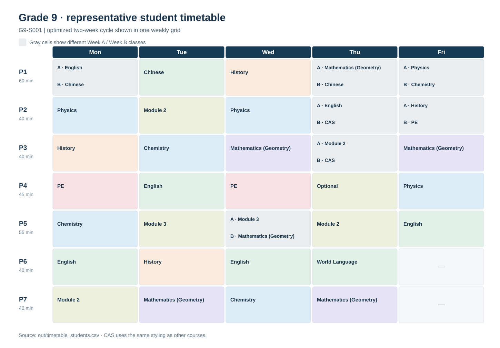
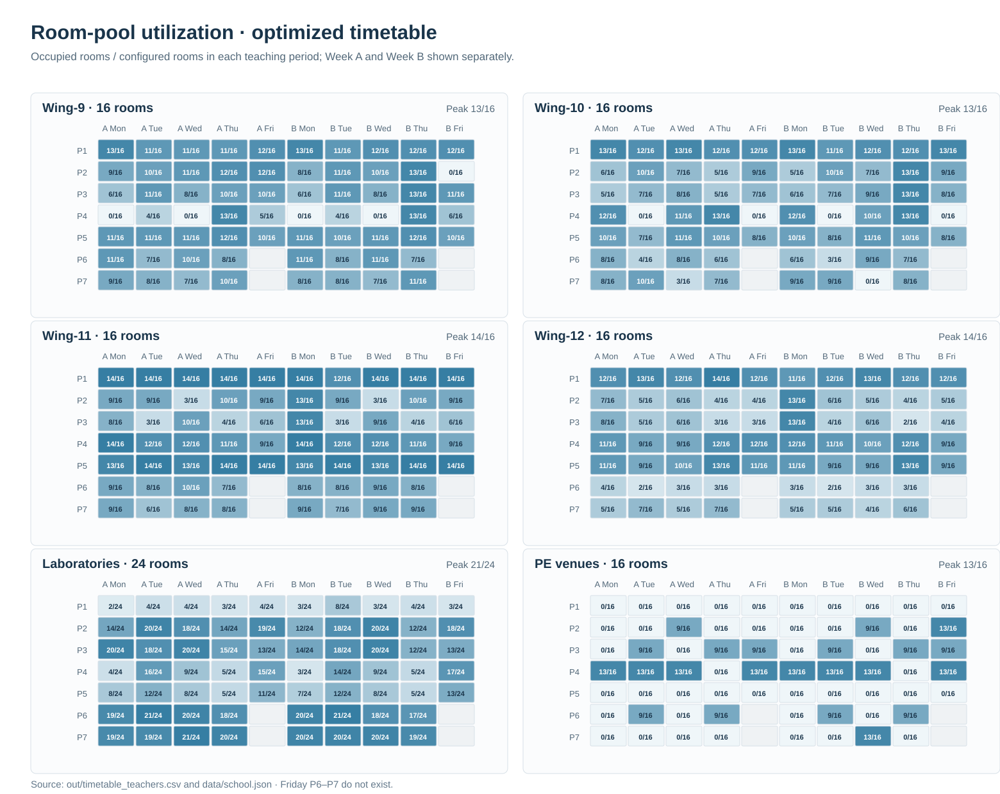

# HackSHSID 2026 · Track 1: Course Timetabling

This project constructs two-week timetables for students, teachers, and rooms in Grades 9–12. It converts course-minute requirements into whole-period sessions, satisfies the implemented hard constraints (H1–H12), and minimizes a weighted soft-cost function. The implementation uses Python 3.10+ and has no runtime dependencies outside the standard library.

The current data represents a **simulation**, not an imported school timetable. Course requirements were curated from a source workbook into `data/curriculum.json`; student enrolments and resource assignments are generated by the model. The source workbook and actual student, staff, and room rosters are not included in this repository.

## Run and verify

From the repository root:

```bash
python3 main.py run
python3 tests/run.py
python3 scripts/render_figures.py
```

The first command runs the default seed-7 experiment with 250 students per grade, three optimization attempts, and 8,000 annealing iterations per attempt. Use `python3 main.py run --help` for the `--students`, `--iters`, `--attempts`, `--seed`, `--data`, and `--out` options. The second command runs the 11 tests without third-party packages. The third regenerates the two figures below from the exported optimized timetable and configured room capacities; run it after each scheduling run. All three commands use only the standard library.

The run writes the following files to `out/`:

| File | Contents |
|---|---|
| `timetable_students.csv` | Scheduled student sessions, including week, day, period, course, teacher, and room |
| `timetable_teachers.csv` | Scheduled teacher sessions and rooms |
| `sections.csv` | Section sizes, assigned teachers and rooms, and required versus scheduled minutes |
| `metrics.json` | Configuration, baseline and optimized costs, and H1–H12 audit counts |
| `report.md` | Baseline-to-optimized comparison |
| `sample_timetables.md` | Complete Week A and Week B examples for one student per grade |

The scheduling command regenerates the CSV, JSON, and Markdown outputs, but not the figures. The earlier PNG files in `out/` predate the CAS rule; use the SVG figures regenerated by `scripts/render_figures.py` for the current model.

## Example timetable and room utilization

The representative Grade 9 timetable below combines Week A and Week B in one weekly grid. A cell with different classes between weeks is light gray and labels each class by week. CAS has the same visual treatment as any other course; its 80-minute double period appears as two adjacent 40-minute cells.



The chart shows occupied physical rooms divided by the configured capacity of each room pool for every teaching period in both weeks. It is based on the optimized teacher timetable, not the infeasible baseline. Friday P6 and P7 are blank because those periods do not exist.



## Model and constraints

The two-week grid has 66 usable periods: seven periods Monday–Thursday and five on Friday, in each week. Periods P1–P7 last 60, 40, 40, 45, 55, 40, and 40 minutes, respectively. Course requirements must be met exactly using sessions of the corresponding period lengths. A complete two-week grid contains 3,040 minutes.

The instance builder creates cohorts with identical course programmes, divides them into sections of at most 20 students, and assigns teachers and rooms subject to the configured resource pools. The default configuration models 16 classrooms per grade wing, 24 shared laboratories, and 16 PE venues. These are **model inputs**, not verified inventories of school facilities. Teachers are assigned on demand and remain within one building. Grades 9, 11, and 12 can fill the grid completely; Grade 10 has 160 minutes of scheduled slack under the standard programme. Individual exemptions or skipped options can create additional free periods.

Three timetable rules warrant particular attention:

- PE, Optional, and CAS sessions are synchronized within each grade for students who take them (H11). Applicable PE and Optional exemptions are represented in the generated enrolments.
- Each grade takes CAS once per two-week cycle in an adjacent 40 + 40-minute double period. Grades 9 and 10 take CAS simultaneously; Grades 11 and 12 do likewise. The two grade-pair blocks may overlap (H12).
- The odd/even stability cost compares the same day and period in Week A and Week B for each student. The first three differing positions are unpenalized; each additional difference costs 8 points. A position containing mandatory CAS in either week is excluded from this count. A room change without a course change does not count.

The independent validator checks H1–H12 after optimization. It checks course enrolment, exact minutes, period validity, capacity, teacher eligibility and availability, resource conflicts, grade synchronization, and the CAS double periods. A zero-violation result is required for a valid timetable; the soft-cost score alone is not a feasibility certificate.

## Scheduling method

1. `scheduler/instance.py` generates student enrolments, cohorts, grade-wide lessons, sections, teachers, and room pools from `data/curriculum.json` and `data/school.json`.
2. `scheduler/planner.py` decomposes each lesson's required minutes into exact 60-, 55-, 45-, and 40-minute session counts while respecting each cohort's available periods.
3. `scheduler/optimize.py` first places sessions in matching Week A/B positions when possible, then repairs conflicts and applies simulated annealing. The search uses individual shifts and swaps as well as moves that preserve or create mirrored pairs. Concrete rooms are assigned per session after scheduling.
4. `scheduler/validate.py` audits the final timetable independently of the optimizer; `scheduler/report.py` exports the results.

Hard conflicts carry a large search cost (`hard_weight = 100,000`), while `data/school.json` defines the soft-cost weights and thresholds. The soft model includes subject alternation, PE timing, subject-time diversity, self-study placement, workload, odd/even stability, and teacher mobility, plus cognitive-load and same-day-repeat terms. Prime-time placement is a reward (negative cost), not a penalty. A larger weight changes the score assigned to candidate schedules; it does not by itself make new timetable moves available.

## Measured result

The committed `out/` files represent the default seed-7 run with 1,000 generated students, 54 cohorts, 43 courses, 442 lessons, 563 sections, 386 assigned teachers, and 104 modeled rooms. The optimizer selected the best of three attempts under the implemented objective.

| Measure | Simulated rigid baseline | Optimized timetable |
|---|---:|---:|
| Hard violations | 6 | **0** |
| Total soft cost | 384,741.33 | **190,851.22** |
| Odd/even stability cost (CAS excluded) | 166,344 | **14,576** |

The optimized soft cost is 50.4% lower than the simulated baseline's. **The baseline is infeasible** because it has six hard violations, so this comparison is an internal diagnostic, not evidence of improvement over an existing valid school timetable. The optimized timetable passed the independent H1–H12 audit and all 11 tests.

Week-to-week consistency remains incomplete: the optimized timetable averages 4.72 non-CAS course differences per student across corresponding weekly positions, and 698 of 1,000 students exceed the three-difference allowance. Increasing only the odd/even weight from 8 to 12 or 20 produced limited improvement in separate trials; those trial weights were not adopted. The committed configuration remains at 8.

## Scope and limitations

- Enrolments are synthesized from the curated grade programmes. Anonymous elective modules are retained under their source labels rather than replaced with invented course names.
- Facility capacities, teacher availability, exemption rates, and optional-course participation are configured assumptions. A school deployment requires verified enrolments, staffing, facilities, and programme rules.
- The optimization is heuristic and does not establish a global optimum or the minimum feasible number of odd/even differences.
- The grade-wide PE requirement and 16-venue configuration limit a grade to at most 320 students at a synchronized PE period; larger instances require a resource or scheduling-policy change.

The implementation and validation logic reside in `scheduler/`, the input configuration in `data/`, and the zero-dependency test suite in `tests/`.
